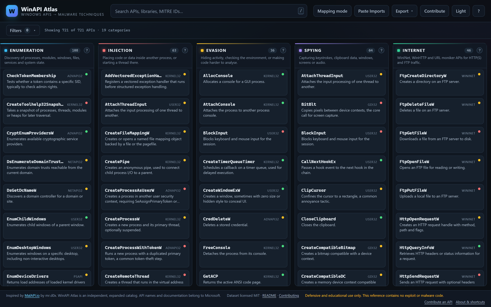

# WinAPI Atlas

**The detection-focused, 721+ Windows APIs mapped to malware techniques, MITRE ATT&CK, Sysmon events, and ETW providers.**

[](LICENSE)
[](data/apis.json)
[](data/categories.json)
[](data/presets.json)
[](#project-structure)

**WinAPI Atlas** is a free, open-source catalog designed for Malware Analysts, SOC Analysts, and Detection Engineers. Every entry documents what a Windows API does, which malware technique category it belongs to, the MITRE ATT&CK technique it supports, the Sysmon Event IDs and ETW providers that observe it, legitimate software use cases (to reduce false positives), and how defenders should correlate it.

🔗 **Live Tool:** [https://winapi-atlas.vercel.app/](https://winapi-atlas.vercel.app/)

> **Defensive and educational use only.** The catalog contains API names, behavioral descriptions, and detection guidance. It contains no exploit code, shellcode, or malware.

---

## Screenshots



---

## Key Features

| Feature | What it gives you |
| --- | --- |
| **721+ Windows APIs** | Real exports from `Kernel32`, `Ntdll`, `Advapi32`, `User32`, `Gdi32`, `Wininet`, `Winhttp`, `Ws2_32`, `Crypt32`, `Bcrypt`, `Amsi`, and more. |
| **19 Technique Categories** | Enumeration, Injection, Evasion, Spying, Internet, Anti-Debugging, Ransomware, Credential Access, Defense Evasion (AMSI/ETW), Process Hollowing, and more. |
| **Suspicion Scoring (`LOW` / `MEDIUM` / `HIGH`)** | Indicates how notable an API is *on its own* during static triage — paired with behavioral context. |
| **Sysmon & ETW Telemetry** | Per-API telemetry mappings (e.g., Sysmon Event IDs 8, 10, 11, 22 and ETW providers like `Microsoft-Windows-Threat-Intelligence`) for building hunt queries. |
| **Legitimate Use Context** | Documents benign software patterns (debuggers, installers, accessibility tools, DRM) so analysts don't treat every API import as malicious by default. |
| **Interactive Mapping Mode** | Select APIs across columns to calculate per-category breakdowns and score known attack technique chains automatically. |
| **Paste Imports Analyzer** | Paste raw output from `PEStudio`, `dumpbin /imports`, `rabin2 -i`, or `strings` to automatically normalize, match, and highlight APIs on the board in one click. |
| **API Variants & NTAPI Counterparts** | Shows `A`/`W`/`Ex` variants and the underlying `ntdll.dll` native syscall counterpart (e.g., `VirtualAllocEx` → `NtAllocateVirtualMemory`). |
| **Deep Linking** | Share direct links to any API (`?api=CreateRemoteThread`) or category (`?cat=injection`). |
| **Multi-Format Exports** | Export mapped selections or filtered views to **CSV**, **JSON**, **Markdown**, or **Sigma-style hunting hints**. |

---

## Quick Usage

### 1. Search & Filter
- Press <kbd>/</kbd> anywhere to focus the global search bar (supports API names, DLLs, MITRE IDs, and subsequence matching like `crt` → `CreateRemoteThread`).
- Combine filters by **Library (DLL)**, **Suspicion Level**, **MITRE Technique**, and **Category**.

### 2. Static Triage with "Paste Imports"
1. Click **Paste Imports** in the top navigation bar.
2. Paste the raw import table or string dump from your analysis tool (`PEStudio`, `dumpbin`, `rabin2`, `objdump`, etc.).
3. WinAPI Atlas strips decorations (`__imp_`, `@16`, `A`/`W` suffixes), activates **Mapping Mode**, highlights all matched APIs, and summarizes the top behavioral categories.

### 3. Exporting Reports
With your APIs selected in Mapping Mode, click **Export** to download your findings as a Markdown table (for incident/malware reports), JSON/CSV, or Sigma-style detection notes.

---

## Running Locally

WinAPI Atlas is built with vanilla HTML, CSS, and ES Modules with **zero external dependencies**. Because it loads `data/*.json` via `fetch()`, run it through any local HTTP server:

```bash
git clone https://github.com/sameralyaghn/winapi-atlas.git
cd winapi-atlas

# Option 1: Built-in zero-dependency Node server
node scripts/serve.mjs          # Opens at http://localhost:8000

# Option 2: Python HTTP server
python -m http.server 8000
```

### Dataset Validation & Tests

To verify dataset integrity (checking for duplicate APIs, broken references, or schema errors) and run the unit test suite:

```bash
node scripts/validate.mjs
node --test tests/
```

---

## Data Schema (`data/apis.json`)

Each API in `data/apis.json` follows a strict, deduplicated schema:

```json
{
  "name": "CreateRemoteThread",
  "aliases": ["CreateRemoteThreadEx"],
  "library": "Kernel32.dll",
  "description": "Creates a thread that runs in the virtual address space of another process.",
  "categories": ["injection"],
  "mitre": [{ "id": "T1055", "name": "Process Injection" }],
  "docs": "https://learn.microsoft.com/en-us/search/?terms=CreateRemoteThread",
  "detection": {
    "summary": "Remote thread creation into another process is a strong injection indicator.",
    "sysmon_events": [8],
    "etw_providers": ["Microsoft-Windows-Threat-Intelligence"],
    "notes": "Look for cross-process thread creation from non-system parents."
  },
  "legit_use": "Debuggers, some installers and security tooling.",
  "related": ["VirtualAllocEx", "WriteProcessMemory", "OpenProcess"],
  "suspicion": "high",
  "verified": true
}
```

### Dataset Breakdown (19 Categories)

| Category | APIs | Category | APIs |
| --- | ---: | --- | ---: |
| Helper | 212 | Enumeration | 108 |
| Crypto | 69 | Network / Sockets | 67 |
| Spying | 64 | Injection | 63 |
| Memory Management | 50 | Internet | 46 |
| Evasion | 36 | Credential Access | 36 |
| Defense Evasion (AMSI/ETW) | 34 | Anti-Debugging | 33 |
| Privilege Escalation | 30 | Service Control | 25 |
| Registry | 23 | Persistence | 20 |
| Lateral Movement | 20 | Process Hollowing | 19 |
| Ransomware | 15 | | |

---

## Contributing

Community contributions (new Windows APIs, deeper Sysmon/ETW detection notes, or direct Microsoft Learn links) are welcome!

1. **In-App Builder:** Click **Contribute** in the top bar of [WinAPI Atlas](https://winapi-atlas.vercel.app/) to fill out the API details, preview the card live on your board (**Test Live on Board**), and click **Open GitHub Issue** to submit the generated JSON in one click.
2. **Pull Requests:** Add or update entries in `data/apis.json`, run `node scripts/validate.mjs` to ensure zero duplicates or schema errors, and open a PR. See [CONTRIBUTING.md](CONTRIBUTING.md) for full details.

---

## Project Structure

```text
index.html            App shell & SEO metadata
css/style.css         Dark/Light themes, responsive grid, modals
js/app.js             Main controller, state & URL synchronization
js/data.js            Catalog loader, NTAPI counterparts & variant lookup
js/state.js           Search, filtering, import parser & technique scoring
js/ui.js              DOM rendering, virtualized columns & modals
js/export.js          CSV, JSON, Markdown & Sigma-style exporters
data/                 apis.json, categories.json, presets.json
scripts/validate.mjs  Dataset schema & deduplication validator
tests/                Unit tests for search, parsing, and exports
```

---

## Credits & License

Created and maintained by **[Samer Al Yaghn](https://github.com/sameralyaghn)**.  

Released under the [MIT License](LICENSE).