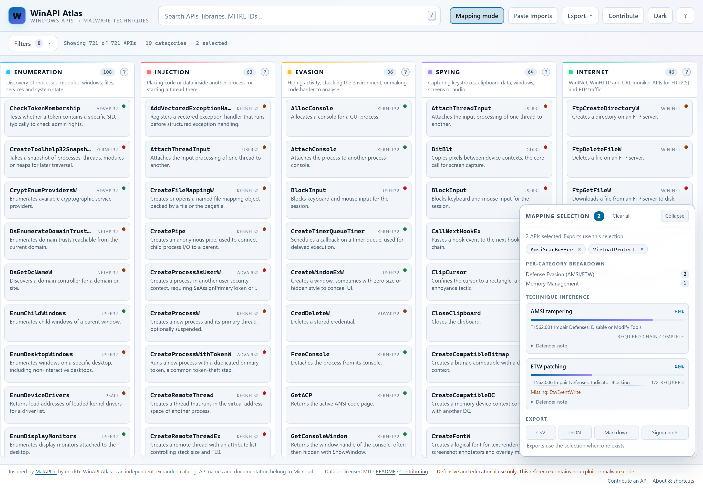
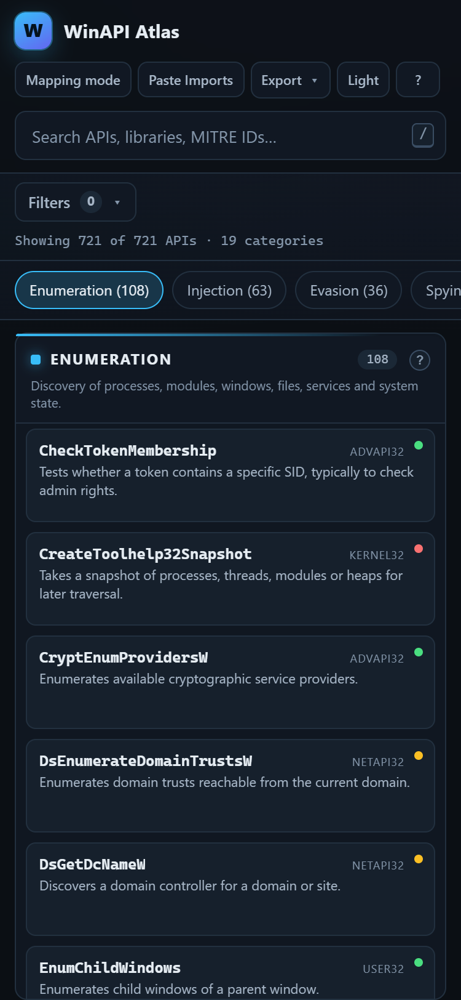
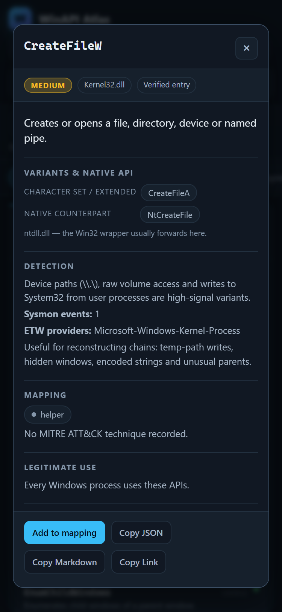

# WinAPI Atlas

**The detection-focused, expanded successor to [MalAPI.io](https://malapi.io/) — 721+ Windows APIs mapped to malware techniques, MITRE ATT&CK, Sysmon events and ETW providers.**

[](LICENSE)
[](data/apis.json)
[](data/categories.json)
[](data/presets.json)
[](#how-it-is-built)

WinAPI Atlas is a free, static catalog for malware analysts, SOC analysts and detection engineers. Every
entry documents what a Windows API does, which malware technique category it belongs to, the ATT&CK
technique it supports, the Sysmon events and ETW providers that observe it, how legitimate software uses
it, and how defenders should correlate it.

> **Defensive and educational use only.** The catalog contains API names, descriptions and detection
> guidance. It contains no exploit code, no shellcode and no malware.

## Live demo & deploy

- **Live site:** <https://winapi-atlas.vercel.app> (replace with your production domain after the first deploy)
- **Deploy your own copy:**

[](https://vercel.com/new/clone?repository-url=https://github.com/your-username/winapi-atlas)

> The deploy button uses a placeholder repository URL. After you publish the repository, replace
> `your-username/winapi-atlas` so the button clones your fork.

## Screenshots

Desktop, dark theme:


Mapping mode with technique inference, light theme:



Mobile layout, one category column at a time:



Mobile detail dialog:



## Key features

| Feature | What it gives you |
| --- | --- |
| **721+ Windows APIs** | Real exports from Kernel32, Ntdll, Advapi32, User32, Gdi32, Wininet, Winhttp, Ws2_32, Crypt32, Bcrypt, Amsi and more. |
| **19 technique categories** | Enumeration, Injection, Evasion, Spying, Internet, Anti-Debugging, Ransomware, Credential Access, Defense Evasion (AMSI/ETW) and friends, rendered as columns. |
| **LOW / MEDIUM / HIGH suspicion** | How suspicious the API is *on its own* — never a verdict on a binary. |
| **Sysmon event IDs** | Per-API event hints (e.g. 8 CreateRemoteThread, 10 ProcessAccess, 11 FileCreate, 22 DNS) for hunt queries. |
| **ETW providers** | The provider that emits the relevant telemetry, including Microsoft-Windows-Threat-Intelligence where applicable. |
| **Legitimate use context** | Who else calls the API, so an alert is not treated as malware by default. |
| **Mapping mode** | Click APIs across columns; the panel counts, breaks down per category and scores known technique chains. |
| **Paste Imports analyzer** | Paste `dumpbin /imports`, `rabin2 -i`, PEStudio output or raw strings and map every recognised API in one step. |
| **API variants & NTAPI hints** | A/W/Ex siblings and the ntdll native counterpart (e.g. `VirtualAllocEx` → `NtAllocateVirtualMemory`) inside each entry. |
| **Deep links** | `?api=VirtualAllocEx` opens an entry, `?cat=injection` opens a category, and **Copy Link** shares both. |
| **Exports** | CSV, JSON, Markdown and Sigma-style hunt hints for the selection or the filtered table. |
| **Zero runtime dependencies** | Static HTML, CSS and ES modules. No framework, no build step, no CDN, works offline. |

## Quick start

The app fetches JSON, so it must be served over HTTP (opening `index.html` from the file system is
blocked by browser CORS rules).

```bash
git clone https://github.com/your-username/winapi-atlas.git
cd winapi-atlas

# option 1: the bundled zero-dependency server
node scripts/serve.mjs          # http://localhost:8000

# option 2: any static server
python -m http.server 8000
npx serve .
```

There is nothing to install and nothing to compile. Node 20+ is only needed for the helper scripts and
tests.

### Build for production

There is no bundler. "Building" means copying the static files as-is:

```bash
# sanity checks that a release should pass
node scripts/validate.mjs       # dataset integrity, exits non-zero on errors
node --test tests/              # filter, URL-state, import-matching and export tests

# optional: produce a clean deployable folder
mkdir -p dist
cp -r index.html favicon.svg robots.txt sitemap.xml vercel.json css js data screenshots dist/
```

`dist/` is a complete static site; the repository root behaves the same way because every path is relative.

## Deploy to Vercel

The project is already configured for Vercel: `vercel.json` enables clean URLs and sets
`X-Content-Type-Options: nosniff`, `X-Frame-Options: DENY` and `Referrer-Policy: strict-origin-when-cross-origin`.

### Option A — Git integration (recommended)

1. Push the repository to GitHub.
2. Go to <https://vercel.com/new> and import the repository.
3. Use these project settings:
   - **Framework preset:** `Other`
   - **Build command:** leave empty
   - **Output directory:** `.` (the repository root)
   - **Install command:** leave empty
4. Click **Deploy**. Vercel serves `index.html`, `css/`, `js/`, `data/`, `robots.txt` and `sitemap.xml`
   directly; no serverless functions, environment variables or build step are required.
5. Add your production domain under **Settings → Domains** if you are not using the assigned
   `*.vercel.app` hostname.

### Option B — Vercel CLI

```bash
npx vercel          # preview deployment
npx vercel --prod   # production deployment
```

`cleanUrls: true` means `/index.html` redirects to `/`, and `?api=`/`?cat=` links keep working because
they resolve to the same static entry point.

### Update the base URL after deploying

The SEO metadata currently assumes `https://winapi-atlas.vercel.app/`. If your deployment uses another
domain, update every occurrence of that string:

| File | What to change |
| --- | --- |
| `index.html` | `<link rel="canonical">`, `og:url`, `og:image`, `twitter:image`, `SoftwareApplication.url` in JSON-LD |
| `robots.txt` | `Sitemap:` URL |
| `sitemap.xml` | every `<loc>` |
| `README.md` | the live demo link |

Then redeploy. Keeping the canonical URL, sitemap and robots file in sync avoids duplicate-content
signals in Google Search.

### Google Search Console

`index.html` ships a verification placeholder:

```html
<!-- Google Search Console verification: replace ADD_CODE_HERE ... -->
<meta name="google-site-verification" content="ADD_CODE_HERE">
```

Replace `ADD_CODE_HERE` with the HTML-tag token from **Search Console → Settings → Ownership
verification**, deploy, then submit `https://winapi-atlas.vercel.app/sitemap.xml` under **Indexing →
Sitemaps**.

## Features in detail

### Columns, search and filters

- One column per category with a sticky header, `?` tooltip and live count.
- Global search matches API names, libraries, descriptions, categories, MITRE IDs and detection notes.
  Search is token-based with a name-subsequence fallback (`crt` → `CreateRemoteThread`). Press
  <kbd>/</kbd> to focus it.
- Filters combine: library, suspicion level, MITRE technique and category columns. Active filters are
  counted on the **Filters** button and reflected in the status line and URL.

### Mapping mode

Turn on **Mapping mode** and click API cards. Selected APIs stay highlighted in every column they
belong to, and a floating panel shows:

- the selected list (remove individual entries or click one to open it),
- a per-category breakdown,
- technique chains matched from `data/presets.json`, scored as
  `80% × required coverage + 20% × optional coverage`,
- export buttons scoped to the selection.

When mapping mode is off, clicking an API opens its detail dialog.

### Paste imports / quick triage

**Paste Imports** in the header opens a local-only analyser. It accepts anything containing API names —
dumpbin listings, `rabin2 -i`, PEStudio output, PE import tables or a pasted strings dump — and:

- normalises `__imp_` prefixes, `_Name@16` stdcall decorations and casing,
- matches exact names plus A/W/Ex variants against all 721 entries,
- switches Mapping mode on with every match selected,
- reports a one-line summary such as
  `Matched 8 APIs across 8 categories · top: Injection (4), Process Hollowing (3), Anti-Debugging (2)`.

Nothing is uploaded; the scan runs in the page. Matching lives in `matchImportNames()` in `js/state.js`
and is covered by unit tests.

### Detail view

`?api=CreateRemoteThread` (or the legacy `#CreateRemoteThread` hash) deep-links to an entry. The dialog
shows the description, library, suspicion, verification status, categories, MITRE links, Microsoft Learn
link, variant/native-API hints, detection guidance (summary, Sysmon events, ETW providers, notes),
legitimate use, clickable related APIs, and **Copy JSON / Copy Markdown / Copy Link** buttons. Closing
the dialog removes `?api=` from the address bar.

### Exports

Exports use the current selection when one exists, otherwise the filtered table. All downloads are
generated in the browser:

| Format | Contents |
| --- | --- |
| CSV | One row per API with aliases, library, suspicion, categories, MITRE, docs, description, detection, Sysmon events, ETW providers, legit use, related and verification flag (RFC 4180 quoting, CRLF). |
| JSON | Versioned envelope (`format`, `version`, `generated_at`, `scope`, `count`, `apis`). |
| Markdown | GitHub-flavoured table, pipes escaped. |
| Sigma-style hints | YAML-shaped comment block with matched technique chains, per-API telemetry hints and category groupings. It is deliberately **not** a runnable Sigma rule. |

### URL state

The open entry is a query parameter so it is crawlable and easy to paste; everything else lives in the
hash:

```text
https://winapi-atlas.vercel.app/?api=VirtualAllocEx
https://winapi-atlas.vercel.app/?cat=injection
https://winapi-atlas.vercel.app/#?q=amsi&cat=defense-evasion&sus=high&lib=Kernel32.dll
 &mit=T1055&sel=AmsiScanBuffer,VirtualProtect&mode=1&theme=light
```

| Parameter | Meaning |
| --- | --- |
| `?api=Name` | Open that entry's dialog (cleared on close). |
| `?cat=id[,id]` | Open one or more category columns on load, then fold into the hash. |
| `q`, `cat`, `lib`, `sus`, `mit` | Search, categories, libraries, suspicion levels, MITRE id. |
| `sel` | Selected API names (Mapping mode selection). |
| `mode=1` | Mapping mode on. |
| `theme=light` | Light theme (dark is the default and omitted). |

Invalid names, category ids, libraries and MITRE ids are dropped on load so a stale link never breaks
the page. Theme is persisted in `localStorage` inside `try/catch` and overridden by the hash when present.

## Data model

`data/apis.json` is the single source of truth. The UI reads `data/apis.json`, `data/categories.json`
and `data/presets.json` and nothing else.

```json
{
  "name": "CreateRemoteThread",
  "aliases": ["CreateRemoteThreadEx"],
  "library": "Kernel32.dll",
  "description": "Creates a thread that runs in the virtual address space of another process.",
  "categories": ["injection"],
  "mitre": [{ "id": "T1055", "name": "Process Injection" }],
  "docs": "https://learn.microsoft.com/en-us/search/?terms=CreateRemoteThread",
  "detection": {
    "summary": "Remote thread creation into another process is a strong injection indicator.",
    "sysmon_events": [8],
    "etw_providers": ["Microsoft-Windows-Threat-Intelligence"],
    "notes": "Look for cross-process thread creation from non-system parents."
  },
  "legit_use": "Debuggers, some installers and security tooling.",
  "related": ["VirtualAllocEx", "WriteProcessMemory", "OpenProcess"],
  "suspicion": "high",
  "verified": true
}
```

| Field | Required | Notes |
| --- | --- | --- |
| `name` | yes | Unique. Real Windows API export name, including `A`/`W`/`Ex` and `Nt*`/`Zw*`/`Rtl*` variants. |
| `aliases` | no | Variant names that are **not** separate entries. |
| `library` | yes | Import library (`Kernel32.dll`, `Ntdll.dll`, …). |
| `description` | yes | Behaviour, not a recipe. |
| `categories` | yes | At least one id from `data/categories.json`. |
| `mitre` | yes (may be empty) | Array of `{ id, name }`. Ids match `T####` or `T####.###`. |
| `docs` | yes | `https://learn.microsoft.com/…` URL. |
| `detection` | yes | `summary` required; `sysmon_events`, `etw_providers`, `notes` optional. |
| `legit_use` | yes | Who uses it legitimately. |
| `related` | yes (may be empty) | Must resolve to existing entries. |
| `suspicion` | yes | `low`, `medium` or `high` — suspicion of the API on its own, not a verdict. |
| `verified` | yes | `false` when a detail could not be cross-checked against a public per-function reference. |

`data/categories.json` entries carry `id`, `title`, `description`, `color` and an `explanation`
(the `?` tooltip). `data/presets.json` entries carry `id`, `title`, `mitre`, `required`, `optional`
and `defender_note`.

### Dataset statistics

721 APIs, 19 categories, 23 technique presets. An API can appear in several columns, so the category
counts below sum to more than 721.

| Category | APIs | Category | APIs |
| --- | ---: | --- | ---: |
| Helper | 212 | Enumeration | 108 |
| Crypto | 69 | Network / Sockets | 67 |
| Spying | 64 | Injection | 63 |
| Memory Management | 50 | Internet | 46 |
| Evasion | 36 | Credential Access | 36 |
| Defense Evasion (AMSI/ETW) | 34 | Anti-Debugging | 33 |
| Privilege Escalation | 30 | Service Control | 25 |
| Registry | 23 | Persistence | 20 |
| Lateral Movement | 20 | Process Hollowing | 19 |
| Ransomware | 15 | | |

### Quality decisions (and their limits)

- **Documentation links** point at Microsoft Learn search for the exact API name rather than guessed
  per-function anchors. Guessed anchors tend to 404 when Microsoft renames pages, and this project
  does not fabricate links. Replace a `docs` value with the canonical page when you add one.
- **Detection text is behavioural.** Per-entry overrides exist for high-value APIs (injection,
  credential access, AMSI/ETW, persistence, networking, ransomware). Entries without an override use
  the category-level guidance from the dataset build, and are still accurate at the category level.
- **`verified: false`** marks 66 native/undocumented entries whose behaviour is well known but which
  lack a public per-function Microsoft reference page. They are listed below.
- **No exploit content.** Entries describe what an API does and what telemetry to collect.
- **Suspicion is not a verdict.** `low` APIs appear in malicious chains all the time; technique
  inference and correlation matter more than any single rating.

Unverified entries:

```
EtwEventSetInformation, EtwNotificationRegister, EtwNotificationUnregister, GetVersionExW,
LdrEnumerateLoadedModules, LdrGetProcedureAddress, LdrLoadDll, LdrRegisterDllNotification,
LdrUnloadDll, NtAllocateVirtualMemory, NtClose, NtCreateFile, NtCreateKey, NtCreateSection,
NtCreateThread, NtCreateThreadEx, NtCreateUserProcess, NtDelayExecution, NtDeleteFile, NtDeleteKey,
NtDuplicateObject, NtFreeVirtualMemory, NtGetContextThread, NtLoadDriver, NtMapViewOfSection,
NtOpenFile, NtOpenKey, NtOpenProcess, NtOpenThread, NtProtectVirtualMemory, NtQueryDirectoryFile,
NtQueryInformationProcess, NtQueryInformationThread, NtQueryKey, NtQueryObject, NtQuerySystemInformation,
NtQueryValueKey, NtQueryVirtualMemory, NtQueueApcThread, NtQueueApcThreadEx, NtReadFile,
NtReadVirtualMemory, NtResumeThread, NtSetContextThread, NtSetInformationProcess, NtSetInformationThread,
NtSetSystemInformation, NtSetValueKey, NtSuspendThread, NtTerminateProcess, NtTestAlert, NtTraceControl,
NtTraceEvent, NtUnloadDriver, NtUnmapViewOfSection, NtWriteFile, NtWriteVirtualMemory,
RtlCreateProcessParametersEx, RtlCreateUserThread, RtlDestroyProcessParameters,
RtlImageDirectoryEntryToData, RtlImageNtHeader, ZwCreateThreadEx, ZwLoadDriver, ZwQuerySystemInformation,
ZwUnmapViewOfSection
```

## Project layout

```text
index.html            app shell, SEO metadata, JSON-LD, crawler fallback
css/style.css         themes, columns, mapping panel, dialogs, responsive layout
js/app.js             controller: state, URL sync, imports, exports
js/data.js            catalog loader, native-API map, variant lookup
js/state.js           pure filters, search, import matching, hash/query parsing
js/ui.js              catalog view, mapping panel, dialogs
js/export.js          CSV / JSON / Markdown / Sigma-style builders
data/                 apis.json, categories.json, presets.json
scripts/validate.mjs  dataset integrity checker
scripts/serve.mjs     zero-dependency static server
tests/                node:test unit suites
robots.txt            crawler policy + sitemap location
sitemap.xml           home page + 19 category landing URLs
vercel.json           clean URLs and security headers
screenshots/          README images
```

## Validation and tests

```bash
node scripts/validate.mjs   # dataset integrity, exits non-zero on any error
node --test tests/          # filter, URL-state, import matching and export tests
```

`validate.mjs` checks JSON parsing, required fields and types, duplicate names, alias collisions, valid
category ids, URL shape, MITRE id format, related-entry resolution, preset references and duplicate
preset ids. It prints API counts per category and the list of unverified entries.

The test suite covers:

- `js/state.js` — hash parse/serialise round-trips, query landing parameters, filtering, search scoring,
  grouping, technique scoring, breakdowns, sanitisation and paste-import matching (`__imp_`, `@N`,
  A/W variants, de-duplication).
- `js/data.js` — variant discovery, native-API counterpart resolution, ATT&CK URL building.
- `js/export.js` — CSV quoting, JSON envelope, Markdown escaping, Sigma-style hints, filename format.

## Accessibility

- Semantic landmarks and headings, skip link, visible `:focus-visible` outlines.
- Filter controls are native checkboxes/selects with labels and counts; category chips expose
  `aria-pressed`; the mapping panel is labelled and collapsible with `aria-expanded`.
- Dialogs use `<dialog>` with `aria-labelledby`; status, copy and import feedback use live regions.
- Contrast targets WCAG AA in both themes; category colours are used for accents and dots, never as
  the only carrier of meaning.
- Columns become swipeable tabs on narrow screens; the layout is usable at 375 px.

## Performance and security

- Each column virtualises its list (fixed 84 px rows, overscan) so only visible cards are in the DOM.
- Data is fetched once in parallel; the grid reserves its area while loading to avoid layout shift.
- No frameworks, no CDN, no web fonts, no network requests beyond the three local JSON files.
- Strict CSP (`default-src 'none'; script-src 'self'; style-src 'self'; connect-src 'self'; …`) plus
  `nosniff`, `DENY` framing and a referrer policy from `vercel.json`.
- All rendered data goes through `textContent`/`createElement`; no `innerHTML` is used. CSS custom
  properties are set through the CSSOM, which is CSP-safe.
- The console stays clean on success; the only log is a fatal catalog-load error.

## Contributing

See [CONTRIBUTING.md](CONTRIBUTING.md). In short: add one object to `data/apis.json`, run
`node scripts/validate.mjs` and `node --test tests/`, then open a PR. The in-app **Contribute** dialog
generates the JSON entry and a prefilled issue description without uploading anything. **Test Live on
Board** injects the draft into the current browser only (`winapi_atlas_drafts` in localStorage) so you
can open its card and detail dialog immediately; drafts are listed in the status bar and can be removed
with **Clear local drafts**. **Open GitHub Issue** opens a prefilled new-issue form once `GITHUB_REPO_URL`
in `js/ui.js` points at the real repository.

## Roadmap

- Per-entry canonical documentation anchors, verified by a link checker in CI.
- Optional Sysmon/ETW event explorer that pivots from an event to the APIs that generate it.
- Saved mappings with names and notes (still client-side, exported as JSON).
- Import-aware reports (grouped by DLL, with first-seen API chains).
- Additional presets for Linux/macOS equivalents and cross-platform ATT&CK mapping.
- Localisation of category titles and detection guidance.

## Credits and license

Inspired by [MalAPI.io](https://malapi.io/) by mr.d0x. WinAPI Atlas is an independent catalog with its
own dataset, taxonomy and UI. Windows API names and Microsoft documentation belong to Microsoft.

Dataset and code are released under the [MIT License](LICENSE).
